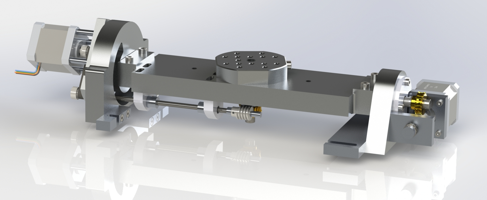
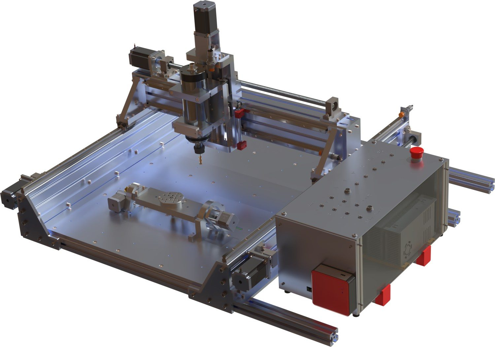

# AC Rotary Table – 4th/5th Axis Rotary Table (Trunnion) for DIY CNC 5-Axis Machining

An open-source hardware **4th/5th axis rotary table** for a **DIY CNC** router: a compact **AC rotary table** (trunnion-style table with two rotary axes, A tilt + C rotation) that extends a hobby 3-axis CNC router to **4-axis and 5-axis** machining. It can be used as a single additional rotary axis (4th axis) or as a unit with two rotary axes in AC or BC configuration.

The goal was a compact and affordable solution that can be mounted on the existing CNC router when needed. It allows machining workpieces from several sides, producing positioned features, engraving cylindrical parts and gaining first experience with simultaneous multi-axis machining. The project is deliberately a DIY development platform – not a commercial series product but a continuously evolving concept for learning, testing and rebuilding.

It was built as an extension of my self-built CNC router **MyCNC** – see [github.com/mallemann/mycnc](https://github.com/mallemann/mycnc).

> **⚠️ Safety and liability – please read first.**
> This is a hobby project, published as-is for inspiration and personal experiments. It is **not** a tested or certified product. Building and operating a CNC machine and a multi-axis rotary table involves mains voltage, rotating spindles and strong motors that can cause serious injury, fire or damage. 5-axis motion adds a high risk of collisions. **You build and use anything from this repository entirely at your own risk.** There is **no warranty and no liability**. See [DISCLAIMER.md](DISCLAIMER.md).

## Contents

| Folder / file | Content |
|---|---|
| [docs/](docs/README.md) | Project documentation (translated from masdrive.ch) and suggested GitHub topics |
| [cad/](cad/README.md) | CAD data: SolidWorks 2022 (native), Fusion 360 (.f3d) and STEP export |
| [images/](images/) | Renderings |
| [DISCLAIMER.md](DISCLAIMER.md) | Safety notes, no warranty, no liability |
| [LICENSE](LICENSE) / [LICENSE-docs](LICENSE-docs) | CERN-OHL-S-2.0 / CC BY-SA 4.0 |

## Documentation

Full description (concept, use as 4th axis, 5-axis configuration, notes for builders): **[docs/ac-rotary-table.md](docs/ac-rotary-table.md)**.

Key points from the project page:

- Use as a single rotary axis (4th axis, indexed machining) or with two rotary axes (AC or BC configuration)
- Designed for compact dimensions on a hobby CNC, sufficient rigidity for light milling work, readily available components and simple construction
- Additional axes driven by my [6-axis CNC controller](https://masdrive.ch/myprojects/projects/6-axis-controller/) (UC300ETH + UB1)
- Status: completed (prototype built and in use)

The masdrive page does not publish numeric specifications (travel, dimensions, ratios). The CAD models are the reference for all dimensions and interfaces.

## CAD

- In this repository: [cad/](cad/README.md) – SolidWorks 2022 assembly `ABC-Table-BG.SLDASM`, Fusion 360 `ABC-Table-BG v1 v13.f3d`, STEP `ABC-Table-BG.STEP`
- On GrabCAD: [Table for 5 Axis CNC with 2 Rotary Axis](https://grabcad.com/library/table-for-5-axis-cnc-with-2-rotary-axis-1)

## Videos

Videos of the table in action (milling with both rotary axes) are on the [masdrive project page](https://masdrive.ch/myprojects/projects/ac-table/).

## Related projects

- **MyCNC** – the DIY CNC router this table was built for: [GitHub](https://github.com/mallemann/mycnc) · [masdrive](https://masdrive.ch/myprojects/projects/cnc-platform/)
- **Mas5ACAM** – 5-axis CAM for X, Y, Z, A, C, developed for the AC table: [GitHub](https://github.com/mallemann/Mas5ACAM) · [masdrive](https://masdrive.ch/myprojects/projects/mas5acam/)
- **MasViewer** – 3D G-code simulation to check tool paths before they run on the machine: [GitHub](https://github.com/mallemann/MasViewer) · [masdrive](https://masdrive.ch/myprojects/projects/gcode-viewer/)
- **4th CNC axis** – simpler single rotary axis with 80 mm chuck: [masdrive](https://masdrive.ch/myprojects/projects/4th-cnc-axis/)

## Licensing

| What | License |
|---|---|
| Hardware design (mechanical design, CAD) | [CERN-OHL-S-2.0](LICENSE) – CERN Open Hardware Licence Version 2, Strongly Reciprocal |
| Documentation, text and images | [CC BY-SA 4.0](LICENSE-docs) – Creative Commons Attribution-ShareAlike 4.0 International |

In short: you may build, modify and share the design, also in modified form, as long as you credit the original and publish your changes under the same terms. Both licenses exclude any warranty and liability. Third-party vendor models included in the CAD files (e.g. bearings, worm gear set, motor) remain the property of their owners and are not covered by these licenses – see [cad/README.md](cad/README.md#third-party-parts).

## Author

Martin Allemann, Switzerland – [masdrive.ch/myprojects](https://masdrive.ch/myprojects/) · [GrabCAD](https://grabcad.com/martin.allemann-1/models) · [GitHub](https://github.com/mallemann)